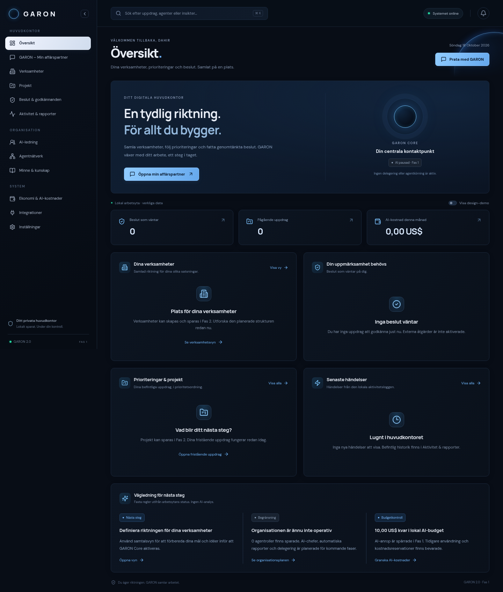

# GARON 2.0 · Fas 1

GARON är Dahirs privata digitala huvudkontor och framtida AI-drivna affärspartner. Den här versionen genomför **Fas 1: omstrukturering och design** på den befintliga GARON-grunden.



[Visa organisationsöversikten](docs/images/organization.png). Bilderna visar gränssnittet, inte en interaktiv förhandsvisning. AI-ledningen är uttryckligen planerad och inaktiv.

## Starta på din Mac

Installera **Node.js 24 eller senare**. Öppna en terminal i projektmappen och kör:

```sh
npm ci
npm run dev
```

Öppna adressen som Vite visar i terminalen, normalt port 5173. API:t kör på port 3001. Ingen API-nyckel behövs.

För den byggda appen:

```sh
npm run build
npm start
```

Den byggda appen och API:t använder då port 3001. API-servern lyssnar lokalt på `127.0.0.1` som standard. Vites utvecklingsserver lyssnar på nätverksgränssnitten för den privata utvecklingsmiljön. Appen saknar autentisering: använd den privat och exponera den inte på internet.

## Vad som är implementerat

- Navigation i grupperna Huvudkontor, Organisation och System.
- Översikt med personlig hälsning, verkliga väntande beslut, prioriterade uppdrag, lokal AI-budget och aktivitet sedan senaste besöket i samma webbläsare.
- Befintlig uppdragshantering under **Projekt → Fristående uppdrag**: skapa, söka, redigera, prioritera, slutföra och radera uppdrag.
- Manuella godkännanden för uppdragsplanering.
- Skapa och pausa agentrollskonfigurationer, utan faktisk agentkörning.
- Globalt minne med sparade anteckningar, aktivitetslogg, sökning och JSON-export.
- Samtalsvy med strategisk och operativ inriktning, exempel på frågor och bevarad tidigare chatthistorik.
- Beständig lokal SQLite-databas och kostnadshistorik.
- En teknisk serverkontroll som nekar AI-anrop i Fas 1, även om en API-nyckel finns.

## Vad som är demonstration eller planerat

- **Verksamheter och projekt:** vyer och struktur finns. SITELY och E-handel visas endast när design-demo är påslaget och märks som demo. De är inte sparade verksamheter. Skapande, redigering och lagring kommer i Fas 2.
- **AI-ledning:** organisationsbilden visar den planerade strukturen Dahir → GARON → OpenAI-chef / Claude-chef → specialiserade agenter. Cheferna kör inte, har inga verktyg och ingen egen aktiv körbudget. Befintliga agentroller kopplas inte automatiskt till dem.
- **Min affärspartner:** riktiga AI-svar är spärrade. Ett uttryckligen märkt demosvar kan visas. Utkastet finns bara i den öppna sessionen och sparas inte vid omladdning. Ingen instruktion utförs.
- **Rekommendationer:** översiktens vägledning bygger på fasta regler, inte AI-analys. Ingen automatisk affärsresearch eller riskbedömning görs.
- **Rapporter:** den verkliga aktivitetsloggen fungerar. AI-genererade rapporter kommer senare.
- **Integrationer och autonomi:** endast informationsvyer. Inga konton ansluts, utskick görs, avtal ingås eller betalningar genomförs.

Fas 1 aktiverar ingen AI och gör inga betalda anrop. Nycklar i befintlig `.env` lämnas orörda och används inte för chatt. Framtida aktivering kräver ett separat godkännande i Fas 3. OpenAI och Anthropic har separata förberedda adaptrar. De automatiserade adaptertesterna använder uteslutande simulerade svar.

## Data och säker övergång

SQLite-filen ligger fortfarande i `.garon/garon.sqlite`. Databasens schema och befintliga postformat är oförändrade. Uppdrag, agentroller, anteckningar, chatthistorik, aktivitet, budget och kostnadshistorik behålls med samma identiteter. Inga demoposter skrivs till databasen.

Inga gamla uppdrag tilldelas en verksamhet eller ett projekt automatiskt. De ligger kvar som fristående uppdrag. Inga gamla anteckningar omklassificeras automatiskt som verifierade fakta.

Data är lokala och okrypterade. Exportknappen i Inställningar skapar en JSON-fil som även innehåller chatthistorik; hantera den som privat information. Import är inte implementerad. För en fullständig databaskopia, stoppa servern och kopiera hela `.garon/` eller använd SQLite backup-API. Nycklar ska aldrig checkas in i Git. `.env` och `.garon/` är ignorerade.

Inför Fas 2 krävs en separat, testad migrationsplan. Se [arkitektur och migrationsplan](docs/phase-1.md).

## Budget

Befintlig månadsbudget och kostnadshistorik är bevarade. Budgeten gäller en kalendermånad i UTC och bara den här installationen. Kostnaderna beräknas från tokenanvändning och modellpris; de är inte fakturor. Osäkra anrop kan ha kvar en reservation. Sätt även en gräns hos leverantören vid framtida aktivering. Kör bara en serverprocess per databas.

## Testa

```sh
npm test
npm run build
npm run test:e2e
```

API-tester använder isolerade databaser och inga riktiga leverantörsanrop. De verifierar befintliga funktioner, tidigare databasformat, AI-spärren och de bevarade adapter- och budgetfunktionerna med simulerade svar.

Webbläsartester använder en separat tillfällig databas och går igenom uppdrag, beslut, minne, agentroller, ny navigation, demo, inaktiv AI samt alla vyer vid mobil- och desktopbredder. De använder Chromium på `/usr/bin/chromium`. På en annan dator anger du miljövariabeln `CHROMIUM_PATH` till din Chrome- eller Chromium-binär. Att köra appen kräver inte Chromium eller Playwright.

## Kodstruktur

```text
src/
  components/              Sidopanel, dialoger och gemensamma panelkomponenter
  features/
    headquarters/          Huvudkontorsöversikt
    organization/          Planerad AI-ledning
    partner/               GARON – Min affärspartner
    workspace/             Uppdrag, minne, kostnader och planerade vyer
  lib/                     Navigation, API-klient, format och delat gränssnittstillstånd
server/
  core/                    Förberedd chatt och gemensam validering
  modules/                 Befintliga API-funktioner uppdelade per område
  providers/               Separata OpenAI- och Anthropic-adaptrar
  policies/                HTTP-skydd
  storage/                 Oförändrad SQLite-lagring
```

Teckensnitt paketeras lokalt. Gränssnittet behöver inga externa CDN:er. Varje senare fas godkänns och verifieras separat.
