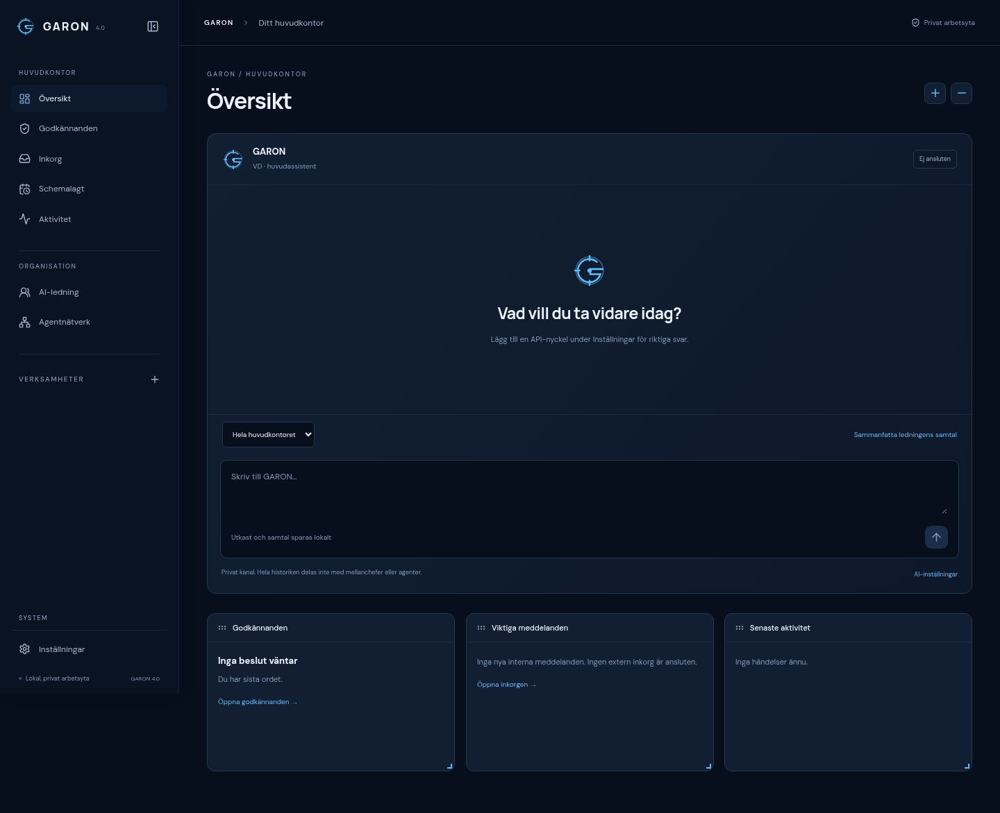

# GARON 4.0

Ditt privata digitala huvudkontor: GARON som huvudassistent, ChatGPT och Claude som mellanchefer, ett gemensamt agentnätverk och verksamheter som du skapar själv. Svenskt gränssnitt, mörkblå design och lokal SQLite-lagring.



[AI-ledning](docs/images/garon4-leadership.png) · [Ljust tema](docs/images/garon4-settings.png) · [Mobilvy](docs/images/garon4-mobile.png)

## Starta på din Mac

1. Hämta [GARON 4.0 som ZIP](https://github.com/dahirmohammed21/Garon/archive/refs/heads/garon-v4.zip) och packa upp filen. Tidigare version ligger kvar i grenen `garon-v1`.
2. Installera **Node.js 24 eller senare** från [nodejs.org](https://nodejs.org/).
3. Stoppa eventuell äldre GARON-server med **Ctrl+C** i dess terminal.
4. Dubbelklicka på **Starta GARON.command** i den uppackade mappen. Första starten hämtar paket och bygger appen; internet behövs då. Webbläsaren öppnas när servern är redo.
5. Låt terminalfönstret vara öppet. Stoppa med **Ctrl+C**.

Om macOS inte låter dig öppna filen: öppna Terminal, skriv `cd `, dra in den uppackade projektmappen och tryck Retur. Kör sedan:

```sh
bash "Starta GARON.command"
```

Öppna **http://127.0.0.1:3001** om webbläsaren inte öppnas automatiskt. Adressen gäller appen på din egen Mac. Öppna inte `index.html` direkt från Finder. Ingen API-nyckel behövs för de lokala funktionerna.

Startfilen återanvänder installerade paket när låsfilen är oförändrad. Vid uppdatering flyttas gamla paket till `node_modules-backup-…` före ominstallationen. Det förebygger det tidigare `ENOTEMPTY`-felet utan att radera din databas. Paketbackuper kan tas bort senare när den nya versionen fungerar.

Manuell installation och produktionsstart:

```sh
npm ci
npm run build
npm start
```

Kör nästa kommando först när föregående lyckats. Om `npm ci` ger `ENOTEMPTY` och nästa kommando säger `concurrently: command not found`, använd startfilen ovan. För utveckling finns `npm run dev`; webbläsaradressen visas i terminalen, normalt port 5173. Kör bara en GARON-backend mot samma databas åt gången.

## Det som fungerar utan API-nycklar

- Fyra navigationssektioner, döljbar sidopanel och dynamiska verksamhetsmappar. Inga verksamheter eller agenter är förskapade.
- Fast GARON-chatt med sparade utkast och historik. Skicka är avstängt tills AI konfigurerats.
- Widgets för verkliga godkännanden, interna meddelanden och aktivitet. Lägg till/ta bort med små plus- och minusknappar; dra och ändra storlek på skrivbordsskärm. Placering och storlek sparas i databasen. På små skärmar visas korten i sparad ordning.
- AI-ledning och globalt agentnätverk: Dahir → GARON → ChatGPT/Claude → agentroller.
- Skapa agent med namn och roll, granska regelbaserat placeringsförslag och spara. Redigera instruktion, mellanchef och verksamhetskopplingar; inaktivera eller ta bort. Sparade roller har inga externa verktyg och är inga självgående processer.
- Tomma verksamheter eller generella mallar. Anpassa undersidor; skapa direkta uppdrag och valfria projekt. Ändra uppdragsstatus manuellt.
- Minnesposter med privat/delad åtkomst, källa, ägarverifiering och verksamhetskoppling. Redigera/radera och kontrollera dubbletter.
- Godkännanden med åtgärd, förslagsställare, verksamhet, risk och kostnadsuppgift när den finns. Att godkänna ett vanligt förslag registrerar beslutet; ingen extern tjänst anropas.
- Intern inkorg och schemalagda påminnelser/uppgifter. Schemaläggaren kontrollerar var 30:e sekund **medan servern körs**. Förfallna objekt tas igen vid nästa start, levereras en gång och kör aldrig AI automatiskt. Redigera eller avbryt väntande objekt.
- Verklig aktivitetslogg, mörkt/ljust tema, accent, täthet, automatisk sparning och återställning av utseendet.
- JSON-export/import och SQLite-säkerhetskopiering under Inställningar → Allmänt.

## Anslut riktiga AI-modeller

1. Öppna **Inställningar → AI-modeller**.
2. Klistra in din OpenAI- och/eller Anthropic-API-nyckel och välj **Spara nyckel**. API-användning faktureras av respektive leverantör; ett vanligt ChatGPT-/Claude-abonnemang ersätter inte API-saldo.
3. Välj **Testa anslutning**. Testet läser leverantörens modellista utan textgenerering. Godkänt test garanterar inte åtkomst till varje modell.
4. Välj modeller och GARONs leverantör. Sätt budget under **Ekonomi och AI-kostnader**.
5. Markera **Aktivera riktiga AI-anrop** och godkänn API-kostnader. Spara.

Därefter finns tre riktiga chattkanaler med separata historiker. GARON kan hämta relevanta delar av mellanchefernas svar. Deras specialiseringar begränsar inte vilka frågor du får ställa.

AI ger också strukturerade verksamhetsförslag och valfria placeringsförslag för agenter. Du granskar innan något skapas. Föreslagna arbetsområden, uppdrag och agentroller sparas som plan; de blir inte automatiskt körningar eller nya agenter.

Via **AI-ledning → Föreslå delegation** skriver du det underlag som får delas och väljer mellanchef och eventuell agentroll. Godkänn förslaget under Godkännanden och välj sedan att köra det. Backend verifierar beslutet och underlaget, förbrukar godkännandet och gör ett enda budgeterat AI-anrop. Ändrad agentinstruktion kräver ett nytt förslag. Resultatet sparas och kan sammanfattas av GARON. AI-svar kan inte ge sig själva systembehörigheter.

**Privat kanal betyder åtkomstseparation inom GARON.** GARONs meddelanden skickas till den valda API-leverantören för att få ett svar. Leverantörens datavillkor gäller. Hela GARON-historiken skickas aldrig automatiskt till mellanchefernas kanaler eller delegerade agentroller. Delegering skickar endast det granskade underlaget och agentinstruktionen, utan privat historik eller minnesposter.

Minneshämtningen väljer högst sex relevanta poster genom ordmatchning. Privata minnen är endast tillgängliga för GARON; verksamhetsminnen används i vald verksamhetskontext. Upp till tio egna historikmeddelanden och fyra relevanta chefsrapporter används, med längdgränser. Inga obegränsade historiker, dokumentindex eller automatiska faktapåståenden sparas som verifierat minne.

Kostnader beräknas från rapporterade token och registrerade USD-priser per miljon token. De är uppskattningar, inte fakturor. En konservativ reservation görs före anropet; vid osäkra fel behålls den. Budgeten gäller kalendermånad i UTC. Modellpriser kan behöva uppdateras i `server/core/ai4.js` och modellernas tillgänglighet kan förändras. Sätt även gränser hos leverantören.

## Var data sparas

| Information | Plats |
| --- | --- |
| Ny installation på Mac | `~/Library/Application Support/GARON/garon.sqlite` |
| Äldre installation med befintlig databas | Projektmappens `.garon/garon.sqlite` återanvänds |
| Linux, ny installation | `$XDG_DATA_HOME/garon/garon.sqlite` eller `~/.local/share/garon/garon.sqlite` |
| API-nycklar sparade i appen | `secrets.enc` och den separata `.vault-key` bredvid databasen |
| Databasbackuper | `backups/` bredvid databasen |
| Tema och navigationscache | Webbläsarens localStorage; tema och widgetlayout finns även i databasen |

Aktuell databasplats visas under **Inställningar → Allmänt**. `GARON_DB` i en privat `.env` anger en exakt databasfil. `GARON_DATA_DIR` anger en permanent datamapp och väljer bort automatisk användning av den gamla `.garon`-mappen. Gör en säkerhetskopia innan du ändrar plats. Nycklar kan alternativt anges genom serverns `OPENAI_API_KEY` och `ANTHROPIC_API_KEY`.

Nycklar krypteras med AES-256-GCM. Valv och huvudnyckel har filbehörighet 0600. Huvudnyckeln finns lokalt, så skyddet ersätter inte säkerheten i ditt macOS-konto. Nycklar returneras aldrig av API:t och ingår inte i JSON-export eller Git. Databasen med chattar och övrig information är **inte krypterad**.

Tidigare manuella anteckningar är bevarade i databasen och exporten. De omvandlas inte automatiskt till delat AI-minne. Vill du använda en sådan anteckning i AI-kontext, skapa en minnespost och välj åtkomst.

## Säkerhetskopiera och uppdatera

**Enkel backup:** Inställningar → Allmänt → Säkerhetskopiera databasen. Det använder SQLite:s backup-API och fungerar medan appen körs. Knappen visar filnamnet. Kopiera backuperna till en annan disk för skydd mot diskfel.

**Fullständig backup inklusive nycklar:** stoppa GARON med Ctrl+C och kopiera hela datamappen, inklusive den dolda `.vault-key` och `secrets.enc`. Hantera kopian som privat. Utan huvudnyckeln går valvet inte att återställa. På Mac visar Cmd+Shift+. dolda filer i Finder.

**JSON:** Exportera alla data ger en läsbar kopia utan API-nycklar eller AI-aktivering. Import tar bara in nya id:n, skriver inte över befintliga poster och aktiverar inte AI. Importerade godkännanden blir vanliga väntande förslag; importerade delegeringar kan inte återanvända gamla körbeslut. Importen återställer inte namn/budget från filens övergripande inställningar. En redan befintlig widget-/utseendekonfiguration skrivs inte över. För exakt återställning, stoppa appen och återställ den fullständiga datamappen.

**Uppdatering:** säkerhetskopiera, stoppa servern, hämta nästa version och starta den. Nya installationers data ligger utanför versionsmappen. Har du äldre data i `.garon/`, behåll eller kopiera hela den katalogen till den nya projektmappen medan servern är stoppad. Kontrollera databasplatsen innan du börjar arbeta. Radera inte den äldre mappen förrän dina data syns i den nya versionen.

Migrering version 4 lägger till ett versionsregister och index utan att skriva om gamla användarposter. En databas med befintliga poster får automatiskt en `before-v4-…`-kopia före första migreringen. Framtida schemaändringar ska läggas till som nya migreringar.

## Senare utveckling

Externa mejl, Gmail, kalender, dokumentanslutningar, publicering, betalningar, riktiga verktygsbehörigheter, självgående agentloopar, schemalagda AI-körningar, molnsynk och en fristående macOS-app är inte aktiva. Integrationskategorierna är markerade som framtida. Grundgränssnitten beskrivs i [arkitektur och fortsättningsplan](docs/garon4.md).

Appen saknar inloggning och lyssnar på loopback som standard. Använd den privat på din dator. Fjärråtkomst behöver separat autentisering och åtkomstskydd.

## Kontroller och utveckling

```sh
npm test
npm run typecheck
npm run build
npm run test:e2e
```

API-tester använder tillfälliga databaser och tydliga testdubblar för leverantörerna. Webbläsartester täcker centrala användarflöden, drag/resize, sparning och huvudvyer i mörkt/ljust vid 320, 390, 768 och 1440 pixlar. Riktiga betalda API-anrop har inte verifierats med dina nycklar. Mac-startfilens installation och serverstart är kontrollerade i Linuxmiljön; Finder och automatisk öppning är ännu inte provade på fysisk Mac.

För webbläsartester i molnmiljön används Chromium på `/usr/bin/chromium`. Ange `CHROMIUM_PATH` på andra datorer. Vanlig appkörning kräver inte Playwright eller Chromium.

React 19 + TypeScript + Vite, Node/Express och SQLite återanvänds. Widgets använder `react-grid-layout` 1.5.4. GARON-symbolen är egen. OpenAI- och Claude-symbolerna kommer från [LobeHub Icons](https://github.com/lobehub/lobe-icons), med MIT-licens i `public/brands/LICENSE-lobe-icons`; märkena tillhör respektive varumärkesägare.
