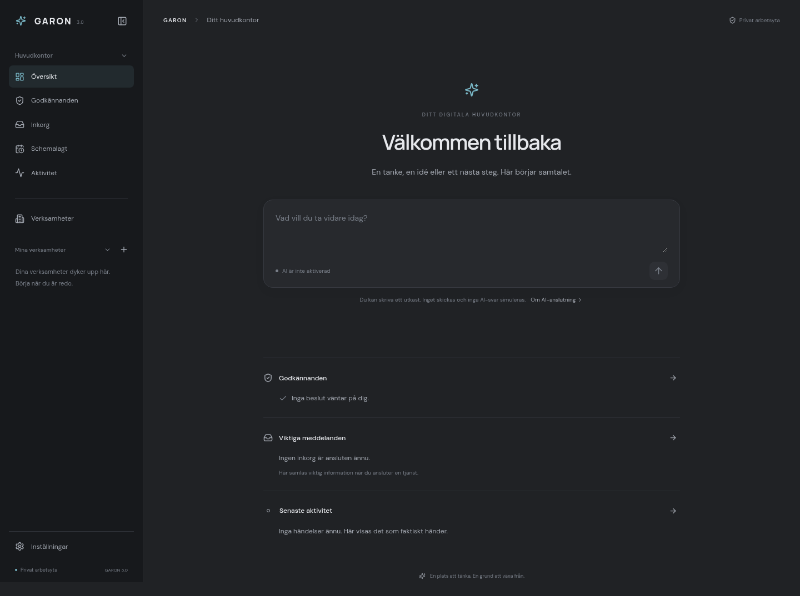

# GARON 3.0

En privat och enkel arbetsmiljö för ditt och GARONs gemensamma huvudkontor. Chatten är centrum. Verksamheter och funktioner läggs till när du behöver dem.



[Verksamheternas nätverksvy](docs/images/garon3-network.png) · [Ljust tema och utseendeinställningar](docs/images/garon3-settings.png) · [Mobilvy](docs/images/garon3-mobile.png)

Bilderna är skärmbilder av den fungerande appen, inte interaktiva förhandsvisningar. Inga exempelverksamheter har lagts in.

## Öppna på din Mac

1. Hämta ZIP-filen från grenen **garon-v1**, eller uppdatera din befintliga Git-checkout.
2. Stoppa eventuell äldre GARON-server med **Ctrl+C** i dess terminal. Behåll gamla mappar och data tills du har en säkerhetskopia.
3. Installera **Node.js 24 eller senare** om det saknas.
4. Öppna Terminal i projektmappen och kör:

```sh
npm ci
npm run dev
```

Öppna den lokala adress som Vite visar i terminalen, normalt port **5173**. Låt terminalen vara öppen medan du använder appen. Ingen API-nyckel behövs.

För att köra det färdiga bygget:

```sh
npm run build
npm start
```

Appen och API:t serveras då tillsammans på port **3001**. Alla kommandon körs i projektets rot. API-servern använder `127.0.0.1` som standard; `HOST`, `PORT` och `GARON_DB` kan anges i en privat `.env`-fil. Vites utvecklingsserver är åtkomlig via nätverksgränssnitten för den privata utvecklingsmiljön. Kör inte flera API-processer mot samma databas.

## Det som fungerar

- **Huvudkontor:** Översikt med GARON-chatten, riktiga väntande godkännanden, tydligt frånkopplad inkorg och verklig senaste aktivitet.
- **Navigation:** döljbar sidopanel, expanderbara sektioner och verksamhetsmappar. Inställningar ligger separat längst ned. Layouten fungerar på mobil och desktop.
- **Verksamheter:** skapa med namn och valfri beskrivning, öppna, redigera, byta namn och ta bort efter bekräftelse. Verksamheterna sparas lokalt i SQLite och finns kvar efter omladdning och serveromstart. Det finns inga förvalda verksamheter.
- **Organisation:** nätverksvy med GARON Core och verkligt skapade verksamheter, samt listvy. Verksamhetsnoder öppnar respektive arbetsyta. Zoomning, panorering och återställning fungerar.
- **Anpassningsbara mappar:** en ny verksamhet får endast Översikt. Via Redigera kan du välja att visa förberedda sidor för Uppdrag och Agenter. Menyerna lagras per verksamhet som metadata och är inte en global, oföränderlig mall.
- **Utseende:** mörkt/ljust tema, blå/lila/grön/orange accent, egen färgväljare samt normal/kompakt sidopanel. Färgerna används centralt i hela gränssnittet. Inställningarna finns kvar efter omladdning och omstart av webbläsaren.
- **Manuella anteckningar:** skapa, läsa, redigera och ta bort egna anteckningar under Inställningar → Minne. De är tydligt skilda från ett framtida automatiskt AI-minne.
- **Allmänt:** svenska som gränssnittsspråk, fungerande val för bekräftelsemeddelanden i appen, information om lokal säkerhet och JSON-export av sparade data. Fel visas även om bekräftelser är avstängda.
- **Bevarade data:** tidigare uppdrag, agentroller, anteckningar, chatthistorik, godkännanden, aktivitet, budget och registrerad användning finns kvar. Äldre backendfunktioner och leverantörsadaptrar är bevarade, även när de inte visas i den nya huvudnavigationen.

## Förberett för framtiden

- **AI:** chatten visar historik och låter dig skriva ett utkast, men Skicka är inaktiverat. Riktiga AI-anrop är spärrade på servern, även om en nyckel finns. Inga falska svar visas. Ett utkast försvinner vid omladdning.
- **AI-modeller:** separata serveradaptrar för OpenAI och Anthropic finns. Inställningarna visar endast om respektive servernyckel är konfigurerad. Det är inte en verifierad eller aktiverad anslutning. Fler leverantörer kan läggas till senare.
- **AI-minne:** automatiskt minne är inte aktiverat. Anteckningar skickas inte automatiskt till någon modell. Det finns ingen knapp som låtsas slå på ett fungerande minnessystem.
- **Inkorg och plugins:** inga e-postkonton, kalendrar, dokumenttjänster eller affärssystem är anslutna. Kategorierna är en framtida struktur, inte installations- eller anslutningsknappar.
- **Schemalagt:** ingen körmotor eller bakgrundsautomatisering är aktiverad.
- **Verksamhetsuppdrag och agenter:** eventuella extra menysidor är tydligt förberedda. Äldre uppdrag flyttas inte automatiskt till en verksamhet och inga agenter skapas eller aktiveras.
- **Godkännanden:** verkliga tidigare ärenden kan godkännas eller avslås för manuell uppdragsplanering. Detta startar inga externa åtgärder, agentkörningar, betalningar eller utskick.

AI-aktivering och betalda anrop kräver ett separat godkännande. API-nycklar ska endast finnas på serversidan; lägg dem aldrig i frontend, localStorage, dokumentation eller Git.

## Var lagras informationen?

| Information | Lagring |
| --- | --- |
| Verksamheter, menystruktur, anteckningar och tidigare arbetsdata | `.garon/garon.sqlite` |
| Tema, accentfärg, täthet och bekräftelsemeddelanden | `garon.v3.preferences` i webbläsarens localStorage |
| Panelens öppet/stängt-läge, expanderade mappar och visningsläge | Separata `garon.v3.*`-nycklar i localStorage |
| Eventuella API-nycklar | Serverns miljö eller ignorerad `.env` |

Webbläsarinställningar gäller den aktuella webbläsarprofilen och adressen. En annan port, privat fönster eller annan webbläsare har egna inställningar. Verksamheterna finns fortfarande i databasen, oberoende av webbläsarprofilen.

Ingen raderande datamigrering behövs. Verksamheter använder en ny posttyp i den befintliga SQLite-tabellen. Gamla poster ändras inte automatiskt. Borttagning av en verksamhet tar endast bort dess metadata, inte tidigare uppdrag eller anteckningar.

**Säkerhetskopiera innan du flyttar mellan mappar:** stoppa servern och kopiera hela `.garon/`, eller använd SQLite backup-API. Exportknappen ger en JSON-kopia för granskning och säkerhetskopiering, men JSON-import är inte implementerad. Databasen är okrypterad. `.garon/` och `.env` är ignorerade av Git.

Appen saknar inloggning och ska användas privat. Publik internetåtkomst kräver ett separat skydd. Utvecklingsmiljöns databas är inte en säkerhetskopia av data som finns separat på din Mac.

## Testa

```sh
npm test
npm run build
npm run test:e2e
```

- **10 API-tester**: bevarade arbetsflöden och gamla databasformat, serverbaserad AI-spärr, verksamhetsvalidering och CRUD, lagring efter serveromstart, anteckningsredigering och säker leverantörsmetadata. Adaptertesterna använder enbart simulerade leverantörssvar, inga riktiga betalda anrop.
- **4 webbläsartester**: tom start, verksamhetsmappar och nätverk, bekräftad borttagning, mörkt/ljust tema, samtliga accentval och egen färg, sparad täthet, manuella anteckningar och inställningar, samt samtliga huvudsidor vid 320, 390, 768 och 1440 pixlar i båda teman.

Webbläsartesterna använder en separat tillfällig databas. Chromium förväntas på `/usr/bin/chromium` i molnmiljön. På en annan dator anger du `CHROMIUM_PATH` till en Chrome- eller Chromium-binär. Den vanliga appen kräver inte Chromium eller Playwright.

## Struktur

```text
src/
  App.tsx                 Applikationens tillstånd, routing och laddning
  features/v3/            Nya sidor, chatt, sidopanel, dialoger och nätverksvy
  lib/v3/                 Central navigation, temasystem och gemensamt tillstånd
  garon3.css              Nya designsystemet med centrala CSS-variabler
server/
  core/                   Bevarad chatt, validering och AI-spärr
  modules/                Verksamheter och tidigare API-funktioner
  providers/              Separata OpenAI- och Anthropic-adaptrar
  policies/               HTTP-skydd
  storage/                Befintlig SQLite-lagring
```

Tidigare komponenter och vyer finns kvar i källkoden men ingår inte i GARON 3.0:s navigation. Historiska anteckningar om Fas 1 beskriver den tidigare versionen. Se [tekniska anteckningar för GARON 3.0](docs/garon3.md) för aktuell struktur och avgränsning.
